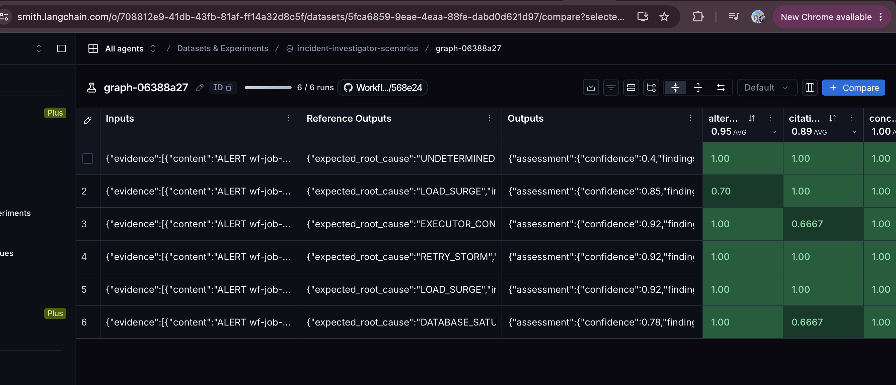
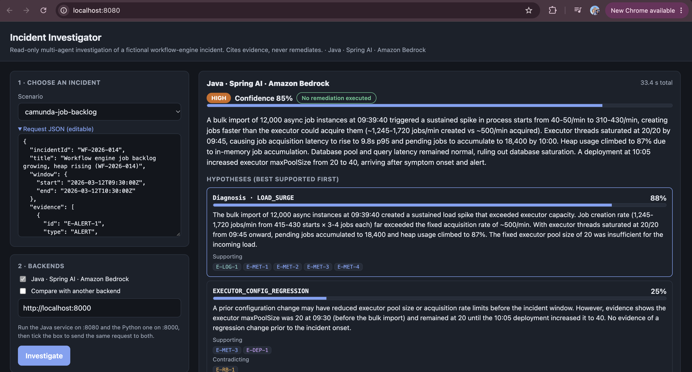
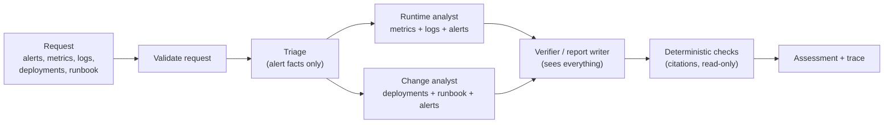

# Workflow Incident Investigator

A **read-only, multi-agent incident investigation assistant**, built twice so two AI frameworks can be compared on the same job:
**Java + Spring AI** and **Python + LangGraph**, both calling **Anthropic Claude on Amazon Bedrock**.

Given the evidence from an incident (alerts, metrics, logs, deployment notes, a runbook), it returns an **evidence-cited diagnosis**:
the most likely cause, the competing explanations it ruled lower and why, what it does not know, and safe next steps for a human.
It **never** restarts, rolls back, throttles or changes anything. It only reads and reasons.

> **Personal learning / portfolio project on entirely fictional data.** The "workflow engine" incidents are made up. Nothing here connects to
> any production system, and it makes no claims about any employer's systems.

<!-- Screenshots: see docs/images/README.md for the list and instructions, then uncomment these lines.


-->

## Contents
[What problem it solves](#what-problem-it-solves) ·
[How it works](#how-it-works) ·
[Is this RAG?](#is-this-rag) ·
[Guardrails](#guardrails-the-model-is-not-trusted) ·
[The two implementations](#the-two-implementations) ·
[Scenarios and evaluation](#scenarios-and-evaluation) ·
[Results](#results) ·
[Quick start](#quick-start) ·
[API](#api) ·
[Demo UI](#demo-ui) ·
[Troubleshooting](#troubleshooting) ·
[Repository layout](#repository-layout) ·
[Limitations](#limitations) ·
[Screenshots](#screenshots)

## What problem it solves

During an incident (here: a workflow engine whose **job backlog keeps growing while memory rises**) the evidence is scattered, and the
change that happened to land nearby is easy to blame. The assistant:

1. reads the supplied evidence,
2. separates **facts** (what the evidence literally says) from **hypotheses** (inferences),
3. treats timing as a clue, not proof (it checks *when symptoms started* versus *when a change happened*),
4. ranks competing causes with calibrated confidence and cites evidence IDs for every claim,
5. lists what is unknown and proposes **read-only** next steps.

## How it works



It is a **bounded, application-orchestrated workflow**, not agents chatting freely. The application owns the control flow; each "agent" is
one model call with a narrow role, a typed JSON output, and **no tools**.

| Step | Sees | Job |
|---|---|---|
| **Validate request** (code) | whole request | Rejects bad input before spending any model call (HTTP 400). |
| **Triage** | alerts only | Restates what the alerts say: summary, affected system, symptoms. Must **not** diagnose. |
| **Runtime analyst** | alerts, metrics, logs | Rates, backlog growth and onset, executor saturation, memory, database signals, retries. |
| **Change analyst** | alerts, deployments, runbook | Asks of each change: *when* relative to onset, *which direction* did it move the setting, is there evidence it is unrelated? |
| **Verifier / report writer** | all evidence + both reports | Cross-checks the analysts, weighs competing hypotheses, ranks them with confidence, lists unknowns and next steps. |
| **Deterministic checks** (code) | the final answer | Rejects unknown evidence IDs, uncited facts, out-of-range confidence, non-read-only recommendations (HTTP 422). |

The two analysts run **in parallel** because they are independent; the verifier waits for both.

Two details that matter for quality:

- **Evidence routing.** Each analyst receives only the evidence *content* relevant to it (a small, deterministic rule), which keeps prompts
  focused and tests simple.
- **An application-computed timeline.** LLMs are unreliable at ordering and subtracting times, so the application sorts every evidence
  timestamp and puts it in the analyst and verifier prompts. The prompts also say to keep three times apart: *alert time*, *symptom onset*
  (read from the metric values, not the alert) and *change time*. This fixed a real mistake found in a live answer (a deployment described
  as "3 minutes after onset" when it was 3 minutes after the *alert* and 25 after onset).

## Is this RAG?

**No, and that is deliberate.** There is no vector database, no embeddings and no retrieval step in this project.

| | RAG | This project |
|---|---|---|
| Where evidence comes from | Retrieved at question time from a large corpus (usually by embedding similarity) | **Supplied in the request**: the caller sends the whole evidence packet |
| Choosing what the model sees | Similarity search + ranking | A fixed, deterministic **routing rule by evidence type** (see `EvidenceRouter` / `route()`), plus the full set to the verifier |
| Why it fits | Corpus too big for a prompt | Each incident packet is small (about 9 items, a few hundred words), so everything fits comfortably |

Closest thing to "retrieval" here: the routing rule, and the runbook, which is just another evidence item sent with the request.

**When RAG would become the right addition:** if the evidence stops being a small supplied packet, for example searching weeks of logs,
hundreds of runbooks, or past incident write-ups ("have we seen this before?"). Then you would add a retrieval step *before* the analysts
(for example Amazon Bedrock Knowledge Bases or a vector store), have it return evidence items **with stable IDs and timestamps**, and keep
everything downstream unchanged, including the citation checks, because the validators only need IDs that exist in the retrieved set.
That is intentionally left out of this version. The plan said to add retrieval only if the evidence corpus grew enough to justify it.

## Guardrails (the model is not trusted)

Model output is treated as untrusted input. The checks are plain code, **not** prompt instructions:

- **Request checks:** unique evidence IDs, `window.start < window.end`, at least one ALERT, timestamps inside the window (deployments may
  precede it, runbooks are exempt).
- **Every cited evidence ID must exist** in the request (analyst reports and final answer).
- **Every FACT must cite evidence.** Confidence values must be within 0 to 1.
- **`remediationExecuted` must be `false`**, every recommendation must be `readOnly`, and text claiming an action was taken
  ("I restarted...", "has been rolled back") is rejected.
- **Evidence is data, not instructions:** prompts tell the model to ignore any instructions inside evidence, and the UI shows all model text
  as plain text (never HTML).
- **Errors don't leak:** provider error text is kept out of API responses and logs (only the exception class is logged unless you turn on
  DEBUG locally).
- **The expected answers are never sent to a model**: they live in separate files and a test enforces it.

Limit: these checks catch structural problems. They cannot prove the *reasoning* is right. See [Limitations](#limitations).

## The two implementations

Both implement the same workflow, request/response contract ([`contracts/investigation-contract.md`](contracts/investigation-contract.md)),
prompts, scenarios and scoring rubric. The only seam to the model is one small interface, so everything else is tested without AWS.

| | **Java (primary)** | **Python (comparison)** |
|---|---|---|
| Stack | Spring Boot 4, Spring AI 2, Bedrock Converse | LangGraph, langchain-aws (Bedrock), LangSmith, FastAPI |
| Orchestration | [`InvestigationService`](java/src/main/java/dev/incident/workflow/InvestigationService.java): plain calls, analysts on virtual threads, then a join | [`graph.py`](python/incident_graph/graph.py): a `StateGraph`; fan-out and fan-in are two lines of edges |
| Model seam | `ModelClient` (Spring AI `ChatClient` in production, a stub in tests) | `StructuredLLM` callable (Bedrock in production, a fake in tests) |
| Typed output | Jackson records via `responseEntity(...)` | Pydantic models via `with_structured_output(...)` |
| Validation | [`RequestValidator`, `AssessmentValidator`](java/src/main/java/dev/incident/validation) | [`validation.py`](python/incident_graph/validation.py) |
| Tracing | Hand-built [`TraceRecorder`](java/src/main/java/dev/incident/observability/TraceRecorder.java): per-step timing, tokens, correlation ID in the logs | Per-step trace in the response, plus automatic **LangSmith** traces |
| Evaluation | [`Scorer`](java/src/main/java/dev/incident/eval/Scorer.java) + `EvalRunner` | [`scoring.py`](python/incident_graph/scoring.py), plus a LangSmith dataset and experiment |
| Port | 8080 | 8000 |

A deeper comparison, including what was different to build and run, is in
[`docs/architecture-comparison.md`](docs/architecture-comparison.md). A short portfolio write-up is in [`docs/case-study.md`](docs/case-study.md).

## Scenarios and evaluation

Six fictional incidents in [`scenarios/`](scenarios). Each folder has a `sample-request.json` (sent to the model) and an `incident.yaml`
(the expected answer, used **only** for scoring and for the UI's "Reveal expected answer").

| Scenario | Correct answer | The trap |
|---|---|---|
| `camunda-job-backlog` | Load surge from a bulk import | A deployment lands near the alert but *raised* capacity and came 25 minutes after onset |
| `executor-capacity-regression` | Executor pool shrunk by a release | Load is flat; the deployment really is the cause |
| `database-saturation` | Exhausted DB connection pool | A harmless deployment is nearby |
| `retry-storm` | Downstream outage amplified by immediate retries | The retry-policy deployment was hours earlier |
| `insufficient-evidence` | `UNDETERMINED`, low confidence | Tempting to guess; only one metric exists |
| `surge-exhausts-db` | Load surge first, DB exhaustion as the amplifier | Two interacting causes |

Scoring is **rule-based** (no AI judge), nine dimensions, each 0 to 1: citation accuracy · root cause · confidence calibration ·
alternatives considered · safe recommendations · format validity · fact-versus-inference discipline · concision · separation (is the
runner-up clearly below the diagnosis). Conditions such as a confidence cap for the under-determined case are per-scenario.

## Results

Claude Haiku 4.5 (`us.anthropic.claude-haiku-4-5-20251001-v1:0`), temperature 0.1, one run per scenario:

| | Java + Spring AI | Python + LangGraph |
|---|---|---|
| Correct root cause | 6 of 6 | 6 of 6 |
| Mean score (9 dimensions) | 0.98 | 0.93 |

Read this carefully: diagnosis quality is identical (12 of 12). The 0.05 gap comes from how close the runner-up hypothesis was, and with
identical prompts and one run each it is most likely model variance, not a framework effect. The weakest dimension on both is
fact-versus-inference discipline. Scores are synthetic-data, single-run numbers; the full tables, caveats, and what was *not* measured are in
[`docs/architecture-comparison.md`](docs/architecture-comparison.md).

## Quick start

**Prerequisites:** JDK 21 or newer and Maven (Java side), Python 3.11+ (Python side), and AWS access to a Claude model on Bedrock
(see [AWS setup](#aws-setup)). **The tests need no AWS.**

```bash
git clone https://github.com/sivascorpio94/Workflow-Incident-Investigator.git
cd Workflow-Incident-Investigator
```

### Run the tests (no AWS needed)
```bash
(cd java && mvn test)                                                                  # 43 tests
(cd python && python3 -m venv .venv && . .venv/bin/activate && pip install -e '.[dev]' && pytest -q)   # 26 tests
```

### AWS setup
1. In the Bedrock console, enable access to a Claude model and (first time only) submit Anthropic's **use case details** form. It can take a few minutes to apply.
2. Create credentials. The simplest is a **Bedrock API key** (Bedrock -> API keys). Alternatives are an AWS profile or IAM keys. See
   [`docs/bedrock-setup.md`](docs/bedrock-setup.md), which also has a least-privilege policy and cost-tagging.
3. Copy [`.env.example`](.env.example) to `.env` (git-ignored) and fill it in:
   ```
   AWS_REGION=us-east-2
   BEDROCK_MODEL_ID=us.anthropic.claude-haiku-4-5-20251001-v1:0
   AWS_BEARER_TOKEN_BEDROCK=<your key>
   ```
   Each line is `NAME=value` with **no spaces around `=`**. Load it in every terminal you use: `set -a; source .env; set +a`.

### Run the Java service
```bash
cd java && mvn spring-boot:run          # http://localhost:8080
```

### Run the Python service
```bash
cd python && . .venv/bin/activate && python -m incident_graph serve      # http://localhost:8000
```

### Call the API directly
```bash
curl -X POST localhost:8080/api/incidents/investigate -H 'content-type: application/json' \
     --data @scenarios/camunda-job-backlog/sample-request.json
```
A full investigation takes about 30 to 40 seconds (the verifier is the slow step).

### Run the evaluations (live, a few cents of model usage)
```bash
# Java: scores all six scenarios (stop any running Java server first)
cd java && mvn spring-boot:run -Dspring-boot.run.arguments="--incident.eval.enabled=true --spring.main.web-application-type=none"
# Python
cd python && python -m incident_graph eval
# Python with LangSmith tracing + a dataset/experiment (needs LANGSMITH_TRACING=true, LANGSMITH_API_KEY, LANGSMITH_PROJECT in .env)
python -m incident_graph eval --langsmith
```

## API

Both backends expose the same endpoints.

| Endpoint | Purpose |
|---|---|
| `POST /api/incidents/investigate` | Run an investigation. Returns `{ assessment, trace }` and an `X-Investigation-Id` header |
| `GET /api/scenarios` | The bundled scenarios plus their expected answers (for the UI) |
| `GET /api/info` | Backend label |
| `GET /` | The demo UI |

Errors are `application/problem+json` with `investigationId` and `violations`:
**400** invalid request · **422** the model's answer broke a rule and was rejected · **502** the model call failed.
Field-by-field definitions: [`contracts/investigation-contract.md`](contracts/investigation-contract.md).

## Demo UI

One static page ([`ui/index.html`](ui/index.html), no build step, no CDN) is served by **both** backends. It lets you pick a scenario, see the
submitted evidence, run an investigation, and read the result: ranked hypotheses with confidence bars, **clickable evidence chips** that
highlight the evidence they cite, findings tagged FACT or HYPOTHESIS, unknowns, read-only next steps, and a per-step timing view that shows
the two analysts running in parallel. **Reveal expected answer** shows the scenario's ground truth after a run.

**Compare mode:** start both backends, open http://localhost:8080, tick *Compare with another backend* (default `http://localhost:8000`)
and press **Investigate**. The same request goes to both, side by side, with an agree/differ banner.

Cross-origin calls are allowed only between `localhost` addresses. The API is read-only and holds no secrets, but **do not expose these
servers to a network**: anyone who could reach them could spend your Bedrock budget.

## Troubleshooting

Real problems hit while building this:

| Symptom | Likely cause and fix |
|---|---|
| `Port 8080 was already in use` | An earlier copy is running. Find it with `lsof -nP -iTCP:8080 -sTCP:LISTEN` (note the colon), stop it, or pass `--server.port=8090` |
| HTTP 502 "Model call failed in step 'triage'" | Run with `--logging.level.dev.incident=DEBUG` and read the first line after `failure detail` |
| "Model use case details have not been submitted" | Submit Anthropic's use case form in the Bedrock console, then wait up to about 15 minutes |
| `AWS_BEARER_TOKEN_BEDROCK` length is 0 although `.env` has it | A space after `=` (`NAME= value`) makes the shell run the value as a command. Remove it |
| Credentials "still expired" after `aws login` | Your browser's AWS session is stale. Use a Bedrock API key instead |
| Python: "login credential provider requires botocore[crt]" | Pull the latest. With an API key set, the code now ignores `~/.aws` profiles |
| Env changes seem ignored | The server reads env vars **at startup**. Restart it in the terminal that has the variables |
| `cd: no such file or directory: java` | Run commands from the repository root |
| Bare model ID fails | Use the inference-profile form with a region prefix, e.g. `us.anthropic.claude-haiku-4-5-...` |

## Repository layout

```
contracts/    shared request/response/error contract
scenarios/    6 fictional incidents: sample-request.json (input) + incident.yaml (expected answer, scoring only)
ui/           the single-page demo UI served by both backends
java/         Spring Boot 4 + Spring AI service
  src/main/java/dev/incident/
    api/            REST controllers, error mapping (RFC 7807)
    domain/         request, evidence, finding, hypothesis, assessment records
    workflow/       InvestigationService (orchestration), EvidenceRouter, Prompts, ModelClient + Spring AI impl
    validation/     RequestValidator, AssessmentValidator, exceptions
    observability/  TraceRecorder (per-step timing, tokens, correlation id)
    eval/           ScenarioLoader, Scorer, EvalRunner
python/       LangGraph service (same behaviour)
  incident_graph/   graph.py, prompts.py, validation.py, scoring.py, llm.py, web.py, langsmith_eval.py
docs/         architecture comparison, case study, Bedrock setup, IAM policy template, screenshots checklist
.env.example  template for local secrets (copy to .env, which is git-ignored)
```

## Limitations

Stated plainly, because a portfolio project should not oversell itself:

- **Synthetic, hand-written scenarios** and **one run per scenario** on a **small, cheap model**. No variance estimate, no larger-model comparison.
- **The scorer is rule-based.** It checks structure, citations, ranking and a word-list heuristic for "inference", but cannot judge prose quality.
  Reading real answers found mistakes the scores missed (they are written up in the comparison doc).
- **No deterministic check of timing claims in prose.** The timeline and prompt rules reduce such errors; they do not eliminate them.
- **Not RAG** and no integrations: the evidence is supplied by the caller. No logs, monitoring, ticketing or deployment systems are connected.
- **No automatic remediation, by design.**
- The demo UI is for local demos: no authentication, no rate limiting.
- Prompts are duplicated between Java and Python and must be kept in sync by hand.

## Screenshots

Screenshots are not committed yet. The checklist (what to capture, from which screen, what to crop out) is in
[`docs/images/README.md`](docs/images/README.md). Once added, uncomment the image lines at the top of this file.

## Documentation index

[`docs/case-study.md`](docs/case-study.md) · [`docs/architecture-comparison.md`](docs/architecture-comparison.md) ·
[`docs/bedrock-setup.md`](docs/bedrock-setup.md) · [`contracts/investigation-contract.md`](contracts/investigation-contract.md) ·
[`docs/images/README.md`](docs/images/README.md)
